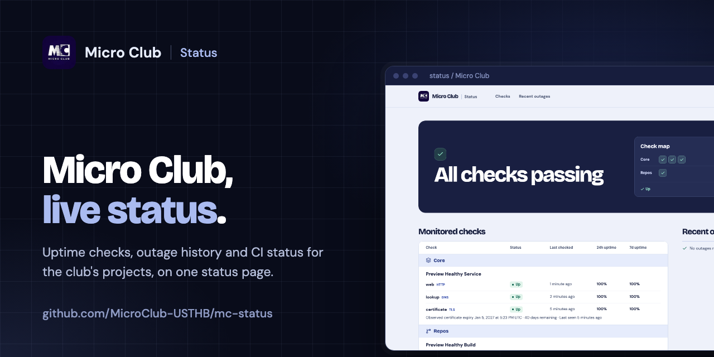
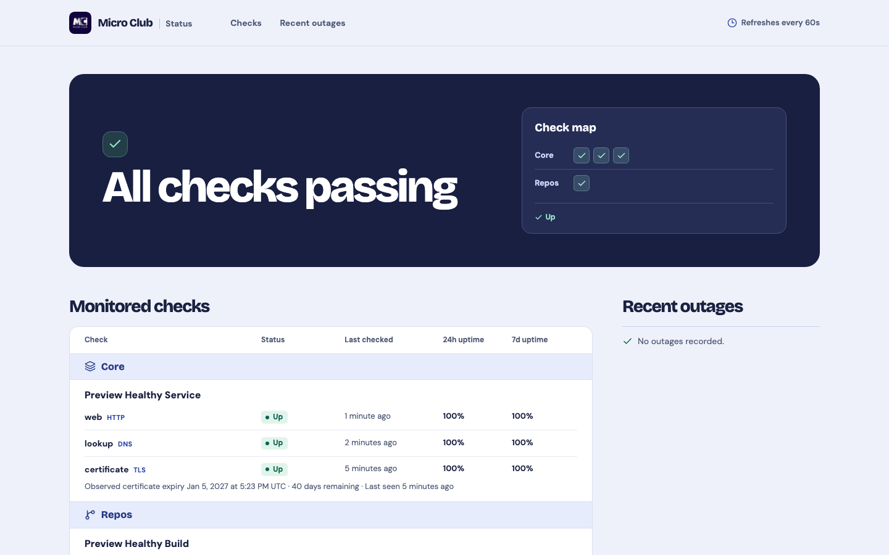

<p align="center">
  
</p>

<h1 align="center">mc-status</h1>

<p align="center">
  A small status monitor for the Micro Club projects. It runs HTTP, TCP, DNS, TLS and GitHub Actions
  checks on a schedule and shows the results and the outage history on one status page.
</p>

<p align="center">
  <a href="https://github.com/MicroClub-USTHB/mc-status/actions/workflows/cd.yml"></a>
  
  
  
  
  
</p>

<p align="center">
  <a href="https://status.164-68-103-224.sslip.io/"><b>Live status page</b></a> &nbsp;·&nbsp;
  <a href="#manage-checks">Manage checks</a> &nbsp;·&nbsp;
  <a href="#build-from-source">Build from source</a> &nbsp;·&nbsp;
  <a href="https://github.com/MicroClub-USTHB/mc-status/issues">Report an issue</a>
</p>

<p align="center">
  
</p>

---

## What it does

- **Five kinds of check:** HTTP, TCP, DNS and TLS (including certificate expiry), plus the latest
  GitHub Actions result of a repository.
- **Outage history:** every outage is recorded with when it started and when it recovered.
- **One page:** a check map, 24 hour and 7 day uptime per check, and the recent outages. It refreshes
  itself every 60 seconds.
- **One file to run:** a standalone executable with the page assets embedded, or a container image.
  Checks live in `targets.yaml`.

## Build from source

On Ubuntu x64 or Ubuntu in WSL2, run `bash scripts/setup-linux.sh release` to install the pinned Bun version and locked dependencies, validate `targets.yaml`, and build the Linux deployment package in `build/linux-x64/`. Missing OS packages may require your `sudo` password. Copy the executable to the deployment folder with your real `targets.yaml` and set any environment variables in the service environment.

### Manual build

Install **Bun 1.4.4**. From the repo root, run:

```sh
bun install --frozen-lockfile
bun run validate
```

| Target | Build command | Output folder |
| --- | --- | --- |
| Linux x64 | `bun run build:linux` | `build/linux-x64/` |
| Windows x64 | `bun run build:windows` | `build/windows-x64/` |

The build copies the root `targets.yaml` into the output folder. The executable includes Bun. To run from source, use `bun run start`.

## Run it

Linux:

```sh
cd build/linux-x64
chmod +x ./mc-status
./mc-status
```

Windows PowerShell:

```powershell
Set-Location build/windows-x64
.\mc-status.exe
```

Run the executable from the folder containing `targets.yaml`. Open [localhost:3000](http://localhost:3000/). Use `/healthz` to check that the process responds and Ctrl+C to stop it.

## Manage checks

Follow the examples in `targets.yaml`. Use `url` for HTTP, TCP, DNS, and TLS, or `repo: owner/repo` for GitHub Actions. An empty address disables a check. Restart after edits. Keep project names and check IDs stable to preserve history.

## Keep it running

Under systemd, set `WorkingDirectory` to the deployed folder and `ExecStart` to the executable's absolute path. Give the service account write access to the database directory. For a service named `mc-status`, view terminal output with `journalctl -u mc-status`.

To update, stop the app, replace the executable, and start it again. Keep the deployed YAML and `data/mc-status.db`. Set `DB_PATH` to move the database or `GITHUB_TOKEN` to authenticate GitHub API requests. Set `PUBLIC_URL` to the address the page is served at, so shared links show the right preview image (it defaults to the production address). Supply them through the process environment.

The status page shows results and outage history. Discord alerts and dedicated log files are pending. To check the monitor from another machine, point a second instance's HTTP check at its `/healthz` endpoint.

## Benchmark

In a source checkout, use the [Linux benchmark runner](scripts/benchmark/README.md) to measure the standalone executable with k6 and `pidstat`.
